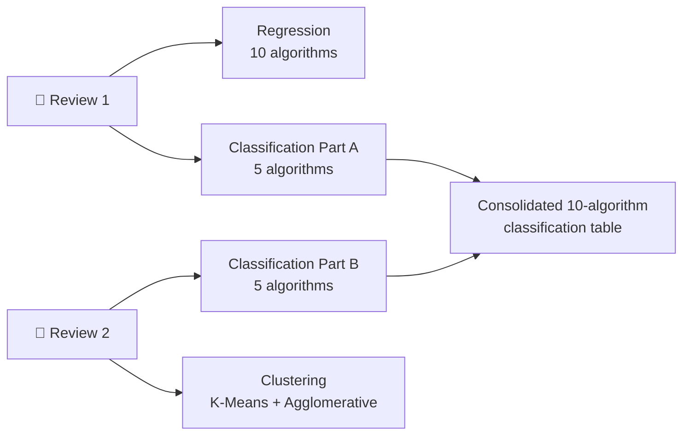
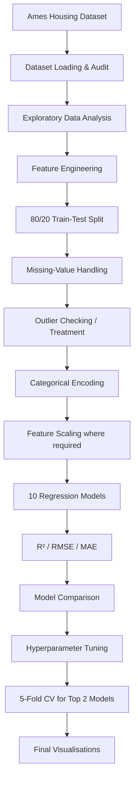
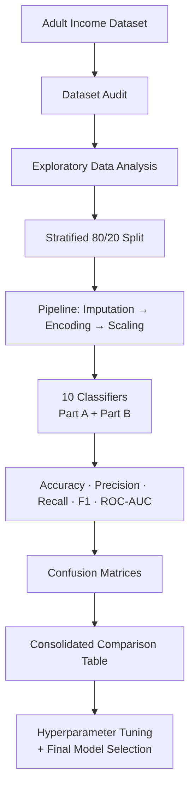
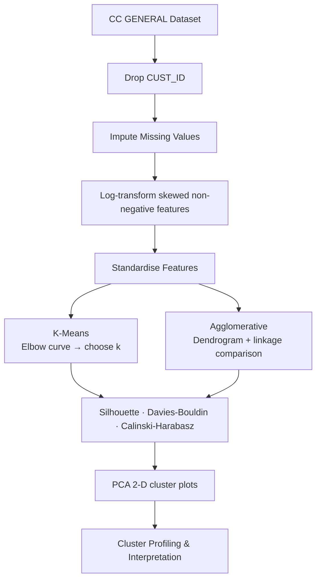

<div align="center">

# 🤖 Machine Learning Capstone Project

### 23CSE301 — Machine Learning · B.Tech CSE (III Year) · Academic Year 2026-27

**Regression · Classification · Clustering — an end-to-end ML pipeline across Review 1 and Review 2**


</div>

---

## 📑 Table of Contents

1. [Project Overview](#-project-overview)
2. [Review Roadmap](#-review-roadmap)
3. [Datasets](#-datasets)
4. [Algorithms Implemented](#-algorithms-implemented)
5. [End-to-End Pipeline](#-end-to-end-pipeline)
6. [Preprocessing & Feature Engineering](#-preprocessing--feature-engineering)
7. [Evaluation Metrics](#-evaluation-metrics)
8. [Results Summary](#-results-summary)
9. [Visualisations](#-visualisations)
10. [Repository Structure](#-repository-structure)
11. [Environment Setup](#-environment-setup)
12. [How to Run](#-how-to-run)
13. [Reproducibility & Data-Leakage Safeguards](#-reproducibility--data-leakage-safeguards)
14. [Capstone Guidelines Compliance](#-capstone-guidelines-compliance)
15. [Progress Tracker](#-progress-tracker)
16. [Technologies Used](#-technologies-used)
17. [Academic Integrity & AI Assistance](#-academic-integrity--ai-assistance)
18. [Team](#-team)
19. [References](#-references)

---

## 🎯 Project Overview

This repository contains the complete implementation of the **23CSE301 Machine Learning Capstone Project**. Each team builds a full, end-to-end Machine Learning pipeline covering three problem tracks:

| Track | Problem Statement | Dataset |
|---|---|---|
| 🏠 **Regression** | Predict the sale price of a residential property from its characteristics | Ames Housing |
| 💼 **Classification** | Predict whether a person's annual income exceeds **$50K** from demographic, education, employment and financial attributes | Adult Income (UCI) |
| 👥 **Clustering** | Segment credit-card customers into meaningful groups based on their usage behaviour, without using labels | CC GENERAL |

The pipeline covers the full workflow: **data loading → audit → EDA → cleaning → feature engineering → model training → comparison → hyperparameter tuning → cross-validation → visualisation**.

---

## 🗓️ Review Roadmap

| Review | Timing | Scope | Marks |
|---|---|---|---|
| **Review 1** | Just before mid-semester exams | Full **Regression** track + **Classification Part A** (5 algorithms) | 25 |
| **Review 2** | Towards the end of the semester | **Classification Part B** (5 algorithms) + full **Clustering** track + README/GitHub quality | 25 (+ up to 2 bonus) |



---

## 📊 Datasets

### 🏠 Ames Housing — Regression (Review 1)

| Property | Details |
|---|---|
| File | `Review-1/data/AmesHousing.csv` |
| Size | 2,930 rows × 82 columns |
| Target | `SalePrice` (continuous) |
| Features | Mixed numerical and categorical — living area, overall quality, year built, basement, garage, neighbourhood, etc. |

### 💼 Adult Income — Classification (Review 1 Part A + Review 2 Part B)

| Property | Details |
|---|---|
| File | `Review-1/data/UCI_Adult_Income_Dataset.csv` |
| Target | `income` — classes `<=50K` and `>50K` |
| Features | Demographic, education, employment and financial attributes |
| Split | Stratified 80:20, `random_state=42` |

> The **same dataset** is used for Part A and Part B so that all ten classifiers are compared fairly.
> If the CSV is missing, the classification notebooks can fetch the Adult dataset through scikit-learn / OpenML (`src/download_adult_dataset.py`).

### 👥 CC GENERAL — Clustering (Review 2)

| Property | Details |
|---|---|
| File | `Review-1/data/CC_GENERAL.csv` |
| Size | 8,950 rows × 18 columns (including `CUST_ID`) |
| Labels | **None** — `CUST_ID` is excluded and no target is used to fit models |
| Why this dataset | Large, feature-rich, and gives explainable customer segments (Cluster 0, Cluster 1, …) |

---

## 🧮 Algorithms Implemented

### 🏠 Regression Track — 10 algorithms (Review 1)

All ten models are trained on the **same preprocessed data** and evaluated on the **same held-out test set**.

| # | Algorithm | Key Notes | Notebook |
|---|---|---|---|
| 1 | Linear Regression | Baseline; interpret coefficients | `01_linear_regression.ipynb` |
| 2 | Ridge Regression | L2 regularisation; tune `alpha` | `02_ridge_regression.ipynb` |
| 3 | Lasso Regression | L1 regularisation; observe feature sparsity | `03_lasso_regression.ipynb` |
| 4 | ElasticNet Regression | L1 + L2; tune `l1_ratio` | `04_elasticnet_regression.ipynb` |
| 5 | Polynomial Regression | `PolynomialFeatures` + Linear Regression; compare degrees | `05_polynomial_regression.ipynb` |
| 6 | Decision Tree Regressor | Tune `max_depth`; feature importance | `06_decision_tree_regressor.ipynb` |
| 7 | Random Forest Regressor | Ensemble baseline; tune `n_estimators` | `07_random_forest_regressor.ipynb` |
| 8 | Gradient Boosting Regressor | Tune `learning_rate` | `08_gradient_boosting_regressor.ipynb` |
| 9 | Support Vector Regressor (SVR) | Scale features; tune `C` and `kernel` | `09_svr.ipynb` |
| 10 | K-Nearest Neighbors Regressor | Tune `k`; discuss impact of scaling | `10_knn_regressor.ipynb` |
| — | **Consolidated comparison** | Ranked table, CV, final plots | `00_regression_model_comparison.ipynb` |

### 💼 Classification Track — 10 algorithms (Part A: Review 1 · Part B: Review 2)

| # | Part | Algorithm | Key Notes | Notebook |
|---|:---:|---|---|---|
| 1 | **A** | Logistic Regression | Baseline; interpret coefficients / odds | `01_logistic_regression.ipynb` |
| 2 | **A** | K-Nearest Neighbors | Tune `k`; discuss distance metrics | `02_knn_classifier.ipynb` |
| 3 | **A** | Gaussian Naive Bayes | Conditional independence assumption | `03_gaussian_naive_bayes.ipynb` |
| 4 | **A** | Decision Tree Classifier | Tune `max_depth`; visualise the tree | `04_decision_tree_classifier.ipynb` |
| 5 | **A** | Support Vector Classifier (SVC) | Tune `C` and `kernel`; scale features | `05_svc.ipynb` |
| 6 | **B** | Random Forest Classifier | Feature importance; tune `n_estimators` | `06_random_forest_classifier.ipynb` |
| 7 | **B** | AdaBoost Classifier | Tune `n_estimators` and `learning_rate` | `07_adaboost_classifier.ipynb` |
| 8 | **B** | Gradient Boosting Classifier | Tune hyperparameters | `08_gradient_boosting_classifier.ipynb` |
| 9 | **B** | Bagging Classifier | Decision Tree as base estimator | `09_bagging_classifier.ipynb` |
| 10 | **B** | MLP Classifier (Neural Network) | Tune `hidden_layer_sizes` and `activation` | `10_mlp_classifier.ipynb` |
| — | — | **Consolidated 10-algorithm comparison** | Single table across all ten models | `00_classification_model_comparison.ipynb` |

### 👥 Clustering Track — 2 algorithms (Review 2)

| # | Algorithm | Key Notes | Notebook |
|---|---|---|---|
| 1 | K-Means Clustering | Elbow curve (inertia vs. *k*) to choose *k* | `clustering.ipynb` |
| 2 | Agglomerative Hierarchical Clustering | Dendrogram; compare linkage strategies | `clustering.ipynb` |

---

## 🔄 End-to-End Pipeline

### Regression workflow



### Classification workflow



### Clustering workflow



---

## 🛠️ Preprocessing & Feature Engineering

All preprocessing is designed to **avoid data leakage**: imputers, encoders, scalers and outlier thresholds are learned from the training data only.

### Regression

| Step | Approach |
|---|---|
| Numerical features | Median imputation; standard scaling for scale-sensitive algorithms |
| Categorical features | Most-frequent imputation + one-hot encoding (unknown categories handled safely) |
| Split | 80% train / 20% test, `random_state=42` — identical across all ten models |
| Outliers | Extreme `Gr Liv Area` values checked using a 3×IQR upper threshold learned from **training data only**; the test set is never filtered |

**Engineered features** (predictor-only; `SalePrice` is never used):

```text
TotalSF         = Total Bsmt SF + 1st Flr SF + 2nd Flr SF

TotalBathrooms  = Full Bath + 0.5 × Half Bath
                + Bsmt Full Bath + 0.5 × Bsmt Half Bath
```

> ✍️ *Team justification for these features is to be written in the final notebook/report.*

### Classification

- Preprocessing is wrapped inside a scikit-learn `Pipeline` / `ColumnTransformer`.
- Missing-value imputation → categorical encoding → feature scaling, all fitted on training data only.
- **Stratified** 80:20 split with `random_state=42`, shared by all ten classifiers.
- The comparison notebook **retrains all ten classifiers**, so it does not depend on result CSVs already existing.

### Clustering

- `CUST_ID` excluded; no target label is used to fit any model.
- Missing values imputed; strongly right-skewed non-negative features are log-transformed; all features standardised.
- **K-Means** assigns clusters to all 8,950 customers.
- **Agglomerative clustering** (and its dendrogram) uses a reproducible **3,000-row sample**, because hierarchical distance calculations need quadratic memory. Both algorithms are compared on the same sample, and the limitation is documented in the notebook.

---

## 📏 Evaluation Metrics

| Track | Metrics |
|---|---|
| 🏠 Regression | **R²**, **RMSE**, **MAE**, plus **5-fold cross-validated R²** for the two best models |
| 💼 Classification | **Accuracy**, **Precision**, **Recall**, **F1 (weighted)**, **Confusion Matrix**, **ROC-AUC** (One-vs-Rest for multi-class) |
| 👥 Clustering | **Silhouette Score**, **Davies-Bouldin Index**, **Calinski-Harabasz Index** |

---

## 📈 Results Summary

> ℹ️ The notebooks are shipped with empty output cells. Run them end-to-end, then replace the placeholders below with your actual numbers and **team-written interpretation**.

### Output locations

| Track | Results folder |
|---|---|
| Regression | `Review-1/results/` |
| Classification Part A | `Review-1/results/classification/` |
| Classification Part B & consolidated | `Review-1/results/review2_classification/` |
| Clustering | `Review-1/results/clustering/` |

### 🏠 Regression — ranked by R² (same held-out test set)

| Rank | Model | R² | RMSE | MAE |
|:---:|---|---:|---:|---:|
| 1 | — | — | — | — |
| 2 | — | — | — | — |
| 3 | — | — | — | — |
| 4 | — | — | — | — |
| 5 | — | — | — | — |
| 6 | — | — | — | — |
| 7 | — | — | — | — |
| 8 | — | — | — | — |
| 9 | — | — | — | — |
| 10 | — | — | — | — |

**Hyperparameter tuning** (minimum two models; currently Ridge via `GridSearchCV` and Random Forest via `RandomizedSearchCV`):

| Model | Search | Parameters tuned | Best parameters | Metric before → after |
|---|---|---|---|---|
| Ridge Regression | `GridSearchCV` | `alpha` | — | — |
| Random Forest Regressor | `RandomizedSearchCV` | `n_estimators`, `max_depth`, `min_samples_split`, `max_features` | — | — |

**5-fold cross-validated R² — top 2 models**

| Model | Fold 1 | Fold 2 | Fold 3 | Fold 4 | Fold 5 | Mean | Std |
|---|---:|---:|---:|---:|---:|---:|---:|
| — | — | — | — | — | — | — | — |
| — | — | — | — | — | — | — | — |

### 💼 Classification — consolidated 10-algorithm table

| Part | Model | Accuracy | Precision | Recall | F1 (weighted) | ROC-AUC |
|:---:|---|---:|---:|---:|---:|---:|
| A | Logistic Regression | — | — | — | — | — |
| A | K-Nearest Neighbors | — | — | — | — | — |
| A | Gaussian Naive Bayes | — | — | — | — | — |
| A | Decision Tree | — | — | — | — | — |
| A | SVC | — | — | — | — | — |
| B | Random Forest | — | — | — | — | — |
| B | AdaBoost | — | — | — | — | — |
| B | Gradient Boosting | — | — | — | — | — |
| B | Bagging (Decision Tree base) | — | — | — | — | — |
| B | MLP | — | — | — | — | — |

**Final model selection:** *— best model, justification, tuned hyperparameters and documented metric improvement —*

### 👥 Clustering — evaluation

| Algorithm | Chosen *k* / linkage | Silhouette ↑ | Davies-Bouldin ↓ | Calinski-Harabasz ↑ |
|---|---|---:|---:|---:|
| K-Means | — | — | — | — |
| Agglomerative | — | — | — | — |

**Cluster profiles / business interpretation:** *— describe each cluster (Cluster 0, Cluster 1, …) in the team's own words —*

---

## 🎨 Visualisations

| Track | Visualisations produced |
|---|---|
| **EDA (Regression)** | Numerical feature distributions, target distribution, correlation heatmap, Overall Quality vs SalePrice, Gr Liv Area vs SalePrice |
| **Regression results** | Predicted vs Actual, Residual plot (best model), tree-based feature importance |
| **Classification** | Confusion matrix per algorithm, comparison chart, Decision Tree visualisation, Random Forest feature importance |
| **Clustering** | K-Means elbow curve, Agglomerative dendrogram, PCA 2-D cluster scatter plots, cluster profile plots |

All plots follow the guideline rules: title, labelled axes, legend where applicable, `tight_layout`, and colour-blind friendly palettes.

---

## 📁 Repository Structure

```text
MachineLearningCaseStudy/
│
├── README.md                    ← this file (Review 1 + Review 2)
├── requirements.txt             ← pinned Python dependencies
├── .gitignore
│
└── Review-1/                    ← keep this folder name; notebooks search upward for it
    │
    ├── data/
    │   ├── AmesHousing.csv                  # Regression
    │   ├── UCI_Adult_Income_Dataset.csv     # Classification (Part A + B)
    │   ├── CC_GENERAL.csv                   # Clustering
    │   └── README.md
    │
    ├── notebooks/
    │   │  ── Regression (Review 1) ──
    │   ├── 00_regression_model_comparison.ipynb
    │   ├── 01_linear_regression.ipynb
    │   ├── 02_ridge_regression.ipynb
    │   ├── 03_lasso_regression.ipynb
    │   ├── 04_elasticnet_regression.ipynb
    │   ├── 05_polynomial_regression.ipynb
    │   ├── 06_decision_tree_regressor.ipynb
    │   ├── 07_random_forest_regressor.ipynb
    │   ├── 08_gradient_boosting_regressor.ipynb
    │   ├── 09_svr.ipynb
    │   ├── 10_knn_regressor.ipynb
    │   │
    │   │  ── Classification Part A (Review 1) ──
    │   ├── 01_logistic_regression.ipynb
    │   ├── 02_knn_classifier.ipynb
    │   ├── 03_gaussian_naive_bayes.ipynb
    │   ├── 04_decision_tree_classifier.ipynb
    │   ├── 05_svc.ipynb
    │   │
    │   │  ── Classification Part B (Review 2) ──
    │   ├── 06_random_forest_classifier.ipynb
    │   ├── 07_adaboost_classifier.ipynb
    │   ├── 08_gradient_boosting_classifier.ipynb
    │   ├── 09_bagging_classifier.ipynb
    │   ├── 10_mlp_classifier.ipynb
    │   ├── 00_classification_model_comparison.ipynb   # all 10 classifiers
    │   │
    │   │  ── Clustering (Review 2) ──
    │   └── clustering.ipynb
    │
    ├── results/
    │   ├── classification/              # Part A outputs
    │   ├── review2_classification/      # Part B + consolidated outputs
    │   └── clustering/                  # Clustering outputs
    │
    ├── models/                          # Fitted model files (joblib .pkl)
    │
    └── src/
        ├── preprocessing.py
        ├── classification_preprocessing.py
        └── download_adult_dataset.py
```

---

## ⚙️ Environment Setup

**Requirements:** Python **3.11+** (a virtual environment is recommended).

```bash
# 1. Clone the repository
git clone <YOUR_GITHUB_REPOSITORY_URL>
cd MachineLearningCaseStudy

# 2. Create a virtual environment
python -m venv .venv

# 3. Activate it
#    Windows:
.venv\Scripts\activate
#    macOS / Linux:
source .venv/bin/activate

# 4. Install dependencies
python -m pip install -r requirements.txt

# 5. Launch Jupyter
jupyter notebook
```

Then open `Review-1/notebooks/`.

---

## ▶️ How to Run

Run every notebook **top-to-bottom** so outputs are visible before submission.

| Step | Notebooks (in order) | What it produces |
|:---:|---|---|
| 1️⃣ | `01` → `10` regression notebooks | Per-model regression results |
| 2️⃣ | `00_regression_model_comparison.ipynb` | Ranked table, 5-fold CV, final plots |
| 3️⃣ | `01` → `05` classification notebooks (Part A) | Part A classification results |
| 4️⃣ | `06` → `10` classification notebooks (Part B) | Part B results, tuning, feature importance |
| 5️⃣ | `00_classification_model_comparison.ipynb` | Consolidated 10-algorithm table |
| 6️⃣ | `clustering.ipynb` | Elbow, dendrogram, metrics, PCA plots |

> ⚠️ The regression and classification notebooks share the numbers `01`–`10`. Run them by **name**, and keep the notebooks inside `Review-1/notebooks/` so the project root is found automatically.
>
> 💡 The regression comparison notebook reads result files written by the ten regression notebooks, so run those first.

---

## 🔒 Reproducibility & Data-Leakage Safeguards

- `random_state = 42` everywhere applicable.
- One consistent split per track (80:20; **stratified** for classification), shared by all algorithms in the track.
- Imputers, encoders, scalers and the outlier threshold are **fit on training data only** and then applied to the test set.
- Clustering never uses labels for fitting.
- Feature-engineering transformations use predictors only — never the target.

---

## ✅ Capstone Guidelines Compliance

How this repository maps to the **23CSE301 Capstone Guidelines & Rubrics**:

### Review 1 (25 marks)

| Rubric section | Marks | Where it is addressed |
|---|:---:|---|
| **A** — Dataset & EDA | 4 | Dataset audit (shape, dtypes, missing values, duplicates, target distribution), distribution plots, correlation heatmap, scatter plots, and written observations in each notebook |
| **B** — Preprocessing & Feature Engineering | 3 | Justified imputation, outlier check, one-hot encoding, train-only scaling, `TotalSF` and `TotalBathrooms` |
| **C** — Regression Track | 9 | 10 algorithms, ranked R²/RMSE/MAE table, `GridSearchCV` / `RandomizedSearchCV`, residual & predicted-vs-actual plots, tree feature importance |
| **D** — Classification Part A | 3 | 5 algorithms with Accuracy, weighted F1, confusion matrix, preliminary table |
| **E** — Presentation & Viva | 6 | Narrative linking each step; every member can explain their code |

### Review 2 (25 marks + up to 2 bonus)

| Rubric section | Marks | Where it is addressed |
|---|:---:|---|
| **A** — Classification Part B | 6 | 5 Part-B algorithms on the same dataset, single 10-algorithm table, final model selection with tuning and documented improvement |
| **B** — Clustering | 8 | K-Means + Agglomerative, Silhouette / Davies-Bouldin / Calinski-Harabasz, elbow curve, dendrogram, PCA plots (t-SNE for at least one algorithm) |
| **C** — Pipeline Integration & Quality | 3 | Clean top-to-bottom notebooks, modular code in `src/`, this README, `requirements.txt`, meaningful commit history |
| **D** — Presentation & Viva | 8 | Story arc: problem → data → method → results → conclusion |
| **Bonus** | +2 | Optional Streamlit/Gradio GUI (+1) and public deployment (+1) |

### Deliverables checklist

| # | Deliverable | Review 1 | Review 2 |
|---|---|:---:|:---:|
| D1 | Clean, fully-run Jupyter notebooks with visible outputs | ✓ | ✓ |
| D2 | GitHub repo with meaningful commit history | ✓ | ✓ |
| D3 | Comparative results tables | ✓ | ✓ |
| D4 | All required visualisations | ✓ | ✓ |
| D5 | README (dataset description, instructions to run) | — | ✓ *(this file)* |
| D6 | Consolidated 10-algorithm classification comparison | — | ✓ |
| D7 | Cluster visualisations (Elbow, Dendrogram, PCA) | — | ✓ |
| D8 | GUI / deployed application | — | optional bonus |

---

## 🚦 Progress Tracker

### Review 1
- [x] Git repository initialised, Ames Housing dataset added, project structure created
- [x] Regression preprocessing pipeline
- [x] All 10 regression notebooks + comparison notebook
- [x] Classification Part A notebooks (5 algorithms)
- [ ] Execute all regression notebooks
- [ ] Execute all Part A classification notebooks
- [ ] Write team interpretations / EDA observations
- [ ] Finalise regression and classification results tables
- [ ] Finalise Review 1 presentation

### Review 2
- [x] Classification Part B notebooks (Random Forest, AdaBoost, Gradient Boosting, Bagging, MLP)
- [x] Consolidated 10-algorithm classification notebook
- [x] Clustering notebook (K-Means + Agglomerative) on CC GENERAL
- [ ] Execute all Part B and clustering notebooks (notebooks ship with empty outputs)
- [ ] Fill in the results tables in this README
- [ ] Confirm a t-SNE plot for at least one clustering algorithm
- [ ] Write team interpretation, model-selection justification and cluster profiles
- [ ] Finalise Review 2 presentation
- [ ] *(Optional)* Streamlit/Gradio GUI and public deployment for bonus marks

---

## 🧰 Technologies Used

| Category | Tools |
|---|---|
| Language | Python 3.11+ |
| Environment | Jupyter Notebook |
| Data | Pandas, NumPy |
| ML | scikit-learn |
| Visualisation | Matplotlib, Seaborn |
| Persistence | Joblib |
| Version control | Git & GitHub |

---

## 🧑‍⚖️ Academic Integrity & AI Assistance

Generative AI was used for **code scaffolding, notebook structure, and development assistance** only, in line with the course policy.

The project team is responsible for:

- Reviewing and understanding every line of code
- Verifying all preprocessing and feature-engineering decisions
- Running and validating all experiments
- Writing the final EDA observations, interpretations, model-selection justification and conclusions
- Explaining the algorithms and results during the viva

All analysis, interpretation and conclusions must be written and verified by the team. Any code taken from external sources is cited in the corresponding notebook.

---

## 👨‍💻 Team

| Name | Roll Number | Responsibility |
|---|---|---|
| Member 1 | Gireesh Vardhan | Regression Track |
| Member 2 | Konudula Deepak | Classification Track |
| Member 3 | Venkata Ramana  | Clustering Track |

> Each member is the primary owner of at least one track and can explain every line of code in it during the viva.

---

## 📚 References

- *23CSE301 Machine Learning — Capstone Project Guidelines, Algorithm List & Evaluation Rubrics* (2026-27)
- Ames Housing Dataset
- UCI Adult Income Dataset
- CC GENERAL Credit Card Customer Dataset
- scikit-learn documentation — https://scikit-learn.org
