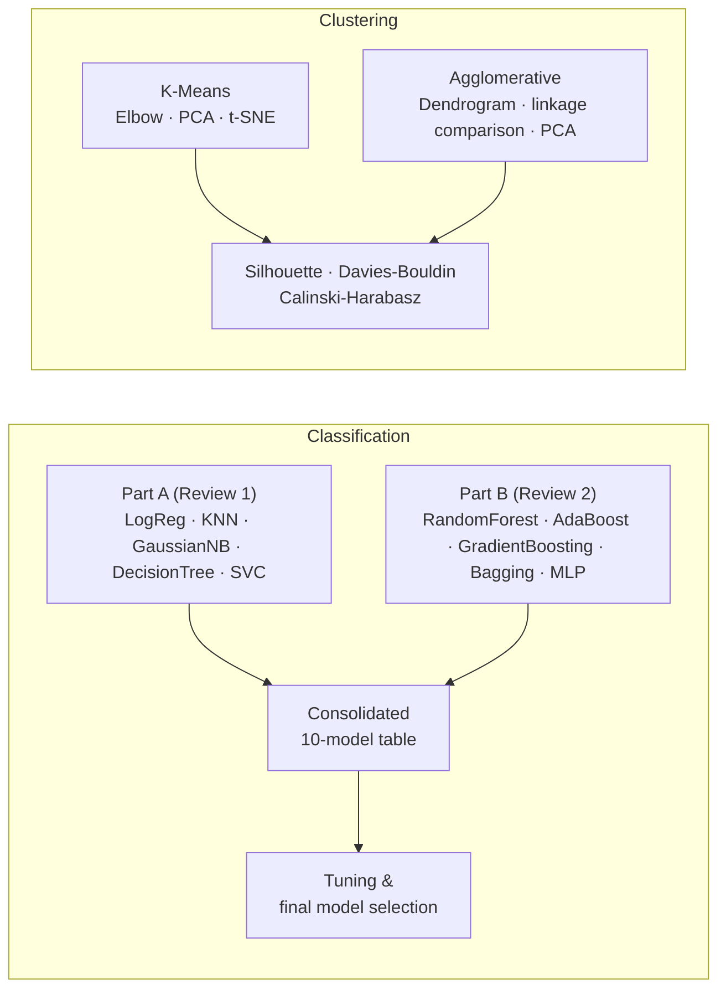
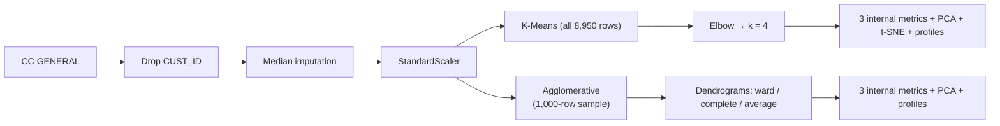

<div align="center">

# Machine Learning Capstone — Review 2

### Classification (Part B + Consolidated 10-Model Comparison) · Clustering
**23CSE301 Machine Learning · B.Tech CSE (III Year) · Academic Year 2026-27**


</div>

---

## 1. Overview

Review 2 completes the capstone with two deliverables:

| Track | Problem | Dataset | Algorithms |
|---|---|---|---|
| **Classification** | Predict whether a person's annual income is above **$50K** | Adult Income (48,842 × 15) | 10 classifiers: Part A (5) + Part B (5), compared in one table |
| **Clustering** | Segment credit-card customers by behaviour, **without labels** | CC GENERAL (8,950 × 18) | K-Means and Agglomerative Hierarchical |

> **Scope note.** This folder contains the Review 2 work only. The Regression track (Ames Housing) was evaluated in Review 1 and is intentionally excluded here. The five Part A classifiers are carried forward from Review 1 so the final comparison covers all ten algorithms on the same dataset.



---

## 2. Run Status

> Update this table after running your notebooks, then delete the block if everything is complete.

| Notebook | Status |
|---|:---:|
| `01`–`05` Part A classifiers | ✅ Saved outputs from Review 1 |
| `06_random_forest_classifier` | ✅ Executed |
| `07_adaboost_classifier` | ✅ Executed |
| `08_gradient_boosting_classifier` | ⏳ Needs a full run |
| `09_bagging_classifier` | ⏳ Needs a full run |
| `10_mlp_classifier` | ⏳ Needs a full run |
| `00_classification_model_comparison` | ⏳ Needs a full run (retrains all 10 models) |
| `11_kmeans_clustering` | ✅ Executed |
| `12_agglomerative_clustering` | ✅ Executed |

Rows marked ⏳ show placeholders (—) in the results below until those notebooks are executed.

---

## 3. Datasets

### 3.1 Adult Income — Classification
| Property | Details |
|---|---|
| File | `data/AdultIncome.csv` |
| Size | **48,842 rows × 15 columns** |
| Target | `class` (loaded as `income`): `<=50K` → 0, `>50K` → 1 |
| Features | `age`, `workclass`, `fnlwgt`, `education`, `education-num`, `marital-status`, `occupation`, `relationship`, `race`, `sex`, `capital-gain`, `capital-loss`, `hours-per-week`, `native-country` |
| Split | Stratified 80 / 20, `random_state=42` → **39,073 train / 9,769 test** |
| Class balance | ≈ 23.9 % positive (`>50K`) in the training set — imbalanced, hence weighted F1 and ROC-AUC are reported |
| Cleaning | `?` and empty strings treated as missing; whitespace stripped from text columns |

### 3.2 CC GENERAL — Clustering
| Property | Details |
|---|---|
| File | `data/CC_GENERAL.csv` |
| Size | **8,950 rows × 18 columns** (17 numeric features + `CUST_ID`) |
| Missing values | `MINIMUM_PAYMENTS` (313), `CREDIT_LIMIT` (1) |
| Duplicates | 0 |
| Labels | **None.** `CUST_ID` is dropped and no target is used to fit any model |
| Typical features | `BALANCE`, `PURCHASES`, `CASH_ADVANCE`, `PURCHASES_FREQUENCY`, `CREDIT_LIMIT`, `PAYMENTS`, `PRC_FULL_PAYMENT`, `TENURE` … |

---

## 4. Methodology

### 4.1 Classification pipeline
All ten classifiers share one split and one leakage-safe preprocessing pipeline (`src/review2_helpers.py`):

| Step | Numeric columns | Categorical columns |
|---|---|---|
| 1. Impute | Median | Most frequent |
| 2. Encode | — | One-hot (`handle_unknown="ignore"`) |
| 3. Scale | `StandardScaler` | `StandardScaler` |

Imputers, encoders and scalers live **inside** a scikit-learn `Pipeline` / `ColumnTransformer`, so they are fitted on training data only.

**Tuning:** `GridSearchCV` with 2-fold stratified CV, scored on weighted F1, using a deliberately compact grid per model.

### 4.2 Clustering pipeline



| Choice | Detail |
|---|---|
| Imputation | Median (robust to the skewed spending variables) |
| Scaling | `StandardScaler`, so large monetary columns do not dominate distances |
| K-Means | `k` chosen from the elbow curve over k = 2…10; `n_init=10`; fitted on **all 8,950 customers** |
| Agglomerative | Ward linkage, k = 4, fitted on a **reproducible random sample of 1,000 customers**; dendrograms use a 400-row subset truncated to the last 30 merges |
| Why sampling | Hierarchical clustering needs pairwise distances (quadratic memory) |
| Silhouette | Computed on a sample (up to 3,000 for K-Means, up to 2,000 for Agglomerative); Davies-Bouldin and Calinski-Harabasz use all rows in the fitted set |
| t-SNE | 2,000-row sample, used for visualisation only |

### 4.3 Evaluation metrics

| Track | Metrics |
|---|---|
| Classification | Accuracy · Precision (weighted) · Recall (weighted) · F1 (weighted) · ROC-AUC · Confusion matrix |
| Clustering | Silhouette ↑ · Davies-Bouldin ↓ · Calinski-Harabasz ↑ |

---

## 5. Notebooks

| Notebook | Purpose |
|---|---|
| `01_logistic_regression` | Part A — baseline classifier |
| `02_knn_classifier` | Part A — distance-based |
| `03_gaussian_naive_bayes` | Part A — probabilistic, conditional independence |
| `04_decision_tree_classifier` | Part A — tree-based |
| `05_svc` | Part A — kernel SVM |
| `06_random_forest_classifier` | Part B — bagged trees, feature importance, tuning |
| `07_adaboost_classifier` | Part B — boosting, tuning |
| `08_gradient_boosting_classifier` | Part B — gradient boosting, tuning |
| `09_bagging_classifier` | Part B — Decision Tree base estimator, tuning |
| `10_mlp_classifier` | Part B — neural network, tuning |
| `00_classification_model_comparison` | Retrains all ten models, one comparison table, confusion matrices, tuning of the top model |
| `11_kmeans_clustering` | Elbow curve, K-Means, metrics, PCA, t-SNE, cluster profiles |
| `12_agglomerative_clustering` | Dendrograms, linkage comparison, Agglomerative, metrics, PCA, profiles |

---

## 6. Results

### 6.1 Classification Part A (carried forward from Review 1)

| Model | Accuracy | F1 (weighted) |
|---|--:|--:|
| Logistic Regression | 0.8525 | 0.8464 |
| K-Nearest Neighbors | 0.8268 | 0.8228 |
| Gaussian Naive Bayes | 0.5889 | 0.6114 |
| Decision Tree | 0.8172 | 0.8178 |
| Support Vector Classifier | 0.8505 | 0.8432 |

*Saved Part A files report Accuracy and weighted F1 only; the consolidated notebook recomputes Precision, Recall and ROC-AUC for all ten models.*

### 6.2 Classification Part B

| Model | Accuracy | Precision | Recall | F1 (w) | ROC-AUC |
|---|--:|--:|--:|--:|--:|
| Random Forest | 0.8567 | 0.8511 | 0.8567 | 0.8522 | 0.9047 |
| Random Forest (tuned) | 0.8567 | 0.8511 | 0.8567 | 0.8522 | 0.9047 |
| AdaBoost | 0.8569 | 0.8512 | 0.8569 | 0.8469 | 0.9070 |
| **AdaBoost (tuned)** | **0.8581** | **0.8519** | **0.8581** | **0.8502** | **0.9110** |
| Gradient Boosting | — | — | — | — | — |
| Bagging (Decision Tree base) | — | — | — | — | — |
| MLP | — | — | — | — | — |

### 6.3 Hyperparameter tuning

| Model | Grid searched | Best parameters | CV F1 (w) | Test improvement |
|---|---|---|--:|---|
| Random Forest | `n_estimators` ∈ {100, 200}, `max_depth` ∈ {None, 20} | `n_estimators=200`, `max_depth=None` | 0.8463 | None — the search selected the baseline settings |
| AdaBoost | `n_estimators` ∈ {100, 200}, `learning_rate` ∈ {0.3, 0.7} | `n_estimators=200`, `learning_rate=0.7` | 0.8467 | F1 0.8469 → 0.8502 · ROC-AUC 0.9070 → 0.9110 |
| Gradient Boosting | `n_estimators` ∈ {100, 150}, `learning_rate` ∈ {0.05, 0.1} | — | — | — |
| Bagging | `n_estimators` ∈ {30, 50}, base `max_depth` ∈ {8, 12} | — | — | — |
| MLP | `hidden_layer_sizes` ∈ {(64,), (100,)}, `activation` ∈ {relu, tanh} | — | — | — |

### 6.4 Consolidated 10-algorithm comparison

*Generated by `00_classification_model_comparison.ipynb`, saved to `results/review2_classification/classification_all_10_models.csv`, and sorted by weighted F1.*

| Rank | Model | Accuracy | Precision | Recall | F1 (w) | ROC-AUC |
|:-:|---|--:|--:|--:|--:|--:|
| 1 | — | — | — | — | — | — |
| 2 | — | — | — | — | — | — |
| 3–10 | *(paste after running the notebook)* | — | — | — | — | — |

**Final model selected:** — *(model, justification, tuned parameters, documented metric improvement)*

### 6.5 Clustering metrics

| Algorithm | Configuration | Data used | Silhouette ↑ | Davies-Bouldin ↓ | Calinski-Harabasz ↑ |
|---|---|---|--:|--:|--:|
| K-Means | k = 4 | 8,950 rows | 0.1965 | 1.5748 | 1598.08 |
| Agglomerative | Ward, k = 4 | 1,000-row sample | 0.1865 | 1.4823 | 163.73 |

**Linkage comparison** (Agglomerative, k = 4, same 1,000-row sample):

| Linkage | Silhouette ↑ | Davies-Bouldin ↓ | Calinski-Harabasz ↑ |
|---|--:|--:|--:|
| Ward | 0.1865 | 1.4823 | 163.73 |
| Complete | 0.8091 | 0.4138 | 102.61 |
| Average | 0.8064 | 0.4889 | 108.18 |

**PCA (2 components)** explains 47.6 % of the variance for K-Means and 49.0 % for the Agglomerative sample.

### 6.6 Cluster profiles (mean values in original units)

**K-Means (k = 4, n = 8,950)**

| Cluster | Customers | Balance | Purchases | Cash advance | Purchase freq. | Credit limit | Payments | Full-payment % |
|:-:|--:|--:|--:|--:|--:|--:|--:|--:|
| 0 | 3,977 | 1,012.66 | 270.04 | 596.51 | 0.17 | 3,278.71 | 974.26 | 0.08 |
| 1 | 409 | 3,551.15 | 7,681.62 | 653.64 | 0.95 | 9,696.94 | 7,288.74 | 0.29 |
| 2 | 1,197 | 4,602.45 | 501.86 | 4,521.51 | 0.29 | 7,546.16 | 3,484.05 | 0.03 |
| 3 | 3,367 | 894.91 | 1,236.18 | 210.57 | 0.89 | 4,213.21 | 1,332.19 | 0.27 |

**Agglomerative (Ward, k = 4, n = 1,000 sample)**

| Cluster | Customers | Balance | Purchases | Cash advance | Purchase freq. | Credit limit | Payments | Full-payment % |
|:-:|--:|--:|--:|--:|--:|--:|--:|--:|
| 0 | 69 | 5,864.73 | 1,014.83 | 6,986.31 | 0.46 | 9,550.72 | 6,181.03 | 0.04 |
| 1 | 496 | 1,454.59 | 245.10 | 1,061.99 | 0.18 | 3,652.43 | 1,110.74 | 0.05 |
| 2 | 431 | 1,044.07 | 1,634.69 | 188.86 | 0.83 | 4,817.99 | 1,680.41 | 0.28 |
| 3 | 4 | 3,997.34 | 31,336.06 | 117.27 | 1.00 | 14,125.00 | 27,768.63 | 0.62 |

> ✍️ **Team to write (own words):** what each cluster represents, why *k* = 4 is supported by the elbow curve and dendrogram, how the three metrics compare across algorithms and linkages, and the limitations (sampling for hierarchical clustering, arbitrary cluster IDs, t-SNE on a sample).

### 6.7 Figures

| Notebook | Figures |
|---|---|
| Classification `01`–`10` | Target distribution, numerical feature distributions, correlation heatmap, confusion matrix (base and tuned), Random Forest feature importance |
| `00_classification_model_comparison` | Five-metric bar chart for all ten models, 2 × 5 grid of confusion matrices |
| `11_kmeans_clustering` | Feature distributions, **elbow curve**, **PCA scatter**, **t-SNE scatter** |
| `12_agglomerative_clustering` | Feature distributions, **dendrograms (Ward / complete / average)**, **PCA scatter** |

---

## 7. Discussion & Conclusions

> ✍️ **Team to write** — the guidelines require original interpretation, so this section is intentionally left for you.
>
> - **Classification:** which model wins and by how much; the trade-off between accuracy, weighted F1 and ROC-AUC on an imbalanced target; why Gaussian Naive Bayes scores far below the others; whether tuning helped each model.
> - **Final model:** justification for the selected model and the documented improvement.
> - **Clustering:** how the two algorithms differ in cluster sizes and metrics; what the linkage comparison shows (check cluster sizes before trusting a high score); business meaning of each segment.
> - **Overall:** lessons learned and future work.

---

## 8. Repository Structure

```text
Review-2/
├── README.md
├── requirements.txt
├── .gitignore
│
├── data/
│   ├── AdultIncome.csv                       # classification (Part A + B)
│   └── CC_GENERAL.csv                        # clustering
│
├── notebooks/
│   ├── 00_classification_model_comparison.ipynb
│   ├── 01_logistic_regression.ipynb          # ── Part A ──
│   ├── 02_knn_classifier.ipynb
│   ├── 03_gaussian_naive_bayes.ipynb
│   ├── 04_decision_tree_classifier.ipynb
│   ├── 05_svc.ipynb
│   ├── 06_random_forest_classifier.ipynb     # ── Part B ──
│   ├── 07_adaboost_classifier.ipynb
│   ├── 08_gradient_boosting_classifier.ipynb
│   ├── 09_bagging_classifier.ipynb
│   ├── 10_mlp_classifier.ipynb
│   ├── 11_kmeans_clustering.ipynb            # ── Clustering ──
│   ├── 12_agglomerative_clustering.ipynb
│   ├── CC_GENERAL_kmeans_cluster_assignments.csv
│   └── CC_GENERAL_agglomerative_cluster_assignments_sample.csv
│
├── results/
│   ├── 01_… 05_*.csv                         # Part A results
│   └── review2_classification/               # Part B + consolidated results
│
└── src/
    ├── review2_helpers.py                    # loading, split, preprocessing pipeline
    ├── classification_preprocessing.py
    ├── preprocessing.py
    └── download_adult_dataset.py
```

---

## 9. Setup & How to Run

**Requirements:** Python 3.11 or 3.12.

```bash
cd Review-2

python -m venv .venv
# Windows:      .venv\Scripts\activate
# macOS/Linux:  source .venv/bin/activate

python -m pip install -r requirements.txt
jupyter notebook
```

Key packages (pinned in `requirements.txt`): `numpy 2.3.5`, `pandas 2.2.3`, `scikit-learn 1.8.0`, `matplotlib 3.10.8`, `seaborn 0.13.2`, `joblib 1.5.3`, `scipy` (dendrograms).

**Run order** (each notebook top to bottom, launched from inside `Review-2/`):

| Step | Notebooks | Output |
|:-:|---|---|
| 1 | `06` → `10` | Part B results in `results/review2_classification/` |
| 2 | `00_classification_model_comparison` | Consolidated 10-model table, charts, tuned top model |
| 3 | `11_kmeans_clustering` | K-Means labels, metrics, plots, assignments CSV |
| 4 | `12_agglomerative_clustering` | Linkage comparison, labels, metrics, plots |

`01`–`05` already contain their saved Review 1 outputs; re-run them only if you want fresh results.

> Keep the top-level folder named **`Review-2`** — the comparison notebook finds the project root by that name — and keep the `data/` and `src/` layout.

---

## 10. Reproducibility

- `random_state = 42` everywhere.
- One stratified 80 / 20 split shared by all ten classifiers.
- Imputation, encoding and scaling are fitted on training data only (inside pipelines).
- The comparison notebook **retrains** all ten models, so it never relies on stale CSV files.
- Clustering never uses a label; `CUST_ID` is excluded.
- Samples for Agglomerative clustering, dendrograms, t-SNE and silhouette scoring are seeded.

---

## 11. Guidelines Compliance (Review 2 Rubric — 25 marks + 2 bonus)

| Rubric item | Marks | Where it is covered |
|---|:-:|---|
| **A1** Part B implementation (5 algorithms, same dataset) | 3 | Notebooks `06`–`10` |
| **A2** Single 10-algorithm table (Accuracy, Precision, Recall, F1, ROC-AUC) | 1 | `00_classification_model_comparison`, §6.4 |
| **A3** Final model selection, tuning, documented improvement | 2 | §6.3 and §6.4 |
| **B1** K-Means + Agglomerative fitted, labels obtained | 4 | Notebooks `11`, `12` + assignment CSVs |
| **B2** Silhouette, Davies-Bouldin, Calinski-Harabasz; elbow curve; dendrogram | 2 | §6.5; elbow in `11`, dendrograms in `12` |
| **B3** PCA plot for each algorithm; t-SNE for at least one | 2 | PCA in `11` and `12`; t-SNE in `11` |
| **C1** Clean, modular, commented notebooks | 1 | Shared code in `src/review2_helpers.py` |
| **C2** README with dataset, problem, results, setup, how-to-run | 1 | This file |
| **C3** GitHub history + `requirements.txt` | 1 | Commit at each milestone; `requirements.txt` included |
| **D1 / D2** Presentation & viva | 3 + 5 | Story: problem → data → method → results → conclusion |
| **Bonus** | +2 | Optional Streamlit/Gradio GUI (+1) and public deployment (+1) |

---

## 12. Academic Integrity

Generative AI was used for **code scaffolding and project organisation only**, as permitted by the course guidelines. The team has reviewed the code and is responsible for running every notebook, verifying the results, and writing its own interpretation, model-selection justification and conclusions. Results in this README come from completed notebook runs.

---

## 13. Team

| Name | Roll Number | Track ownership |
|---|---|---|
| — | — | Classification |
| — | — | Clustering |
| — | — | Pipeline / documentation |

---

## 14. References

- *23CSE301 Machine Learning — Capstone Project Guidelines, Algorithm List & Evaluation Rubrics* (2026-27)
- UCI Adult Income Dataset · CC GENERAL Credit Card Customer Dataset
- scikit-learn documentation — https://scikit-learn.org
